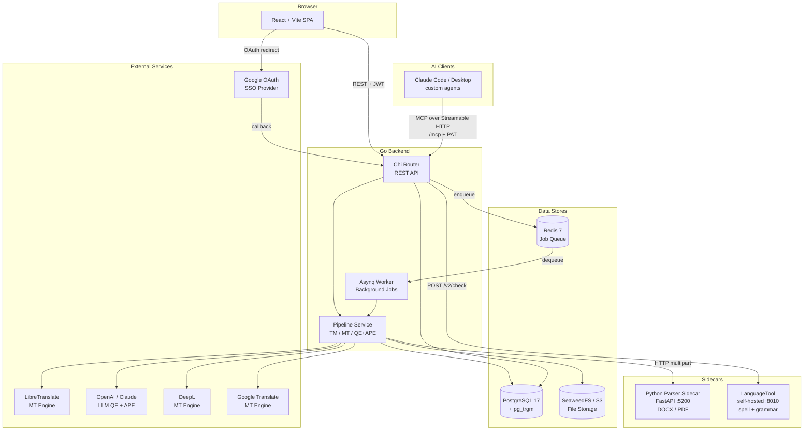
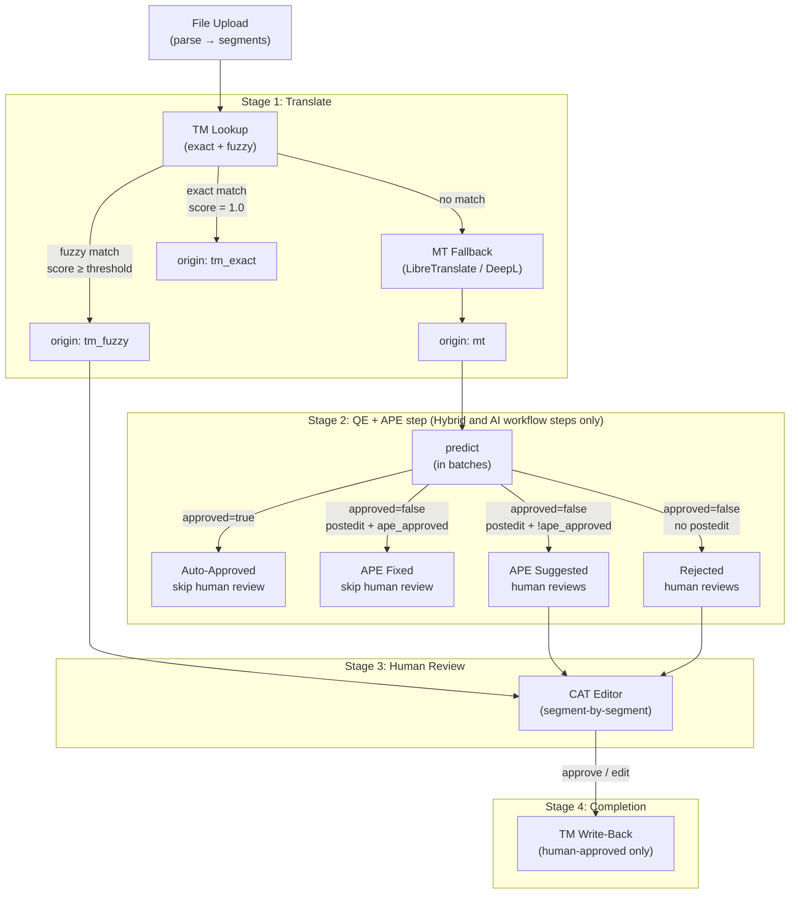
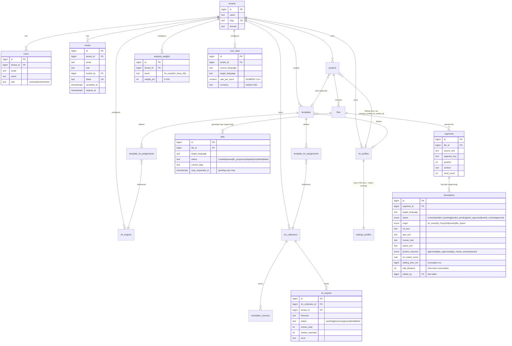
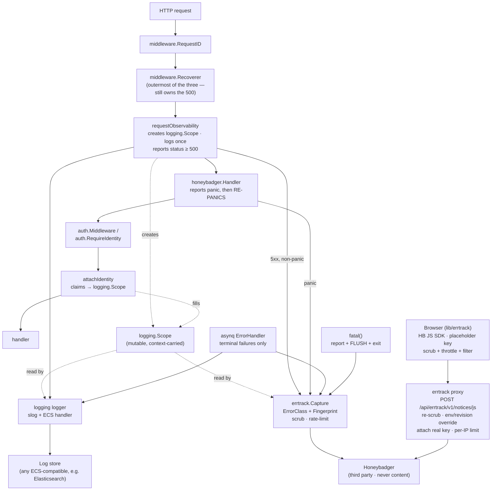
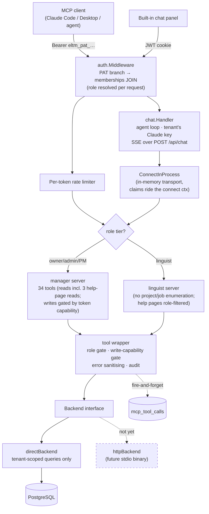
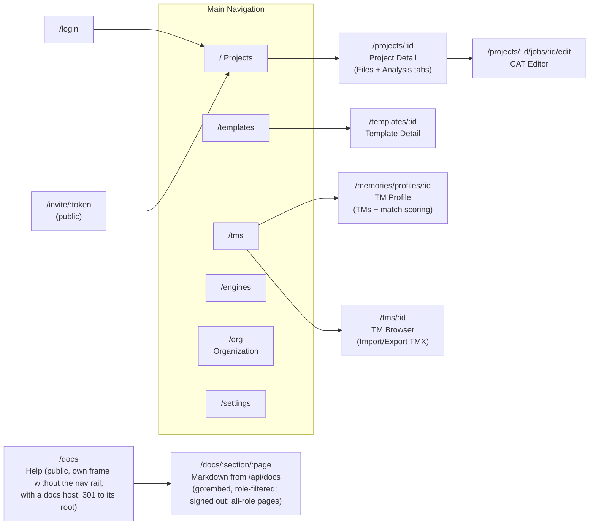

# OpenLoc Architecture

> Diagrams use [Mermaid](https://mermaid.js.org/). Install your IDE's Mermaid plugin to see rendered visuals.

## System Overview



## Pipeline Flow

The core translation pipeline runs per file per target language (= one "job").



## Entity Relationship Diagram



## Observability

Two destinations with **different sensitivity rules**. Structured logs (slog,
ECS format) carry request, tenant and user identity from `logging.Scope`.
Error-tracking notices go to a third party and must not carry customer content
or credentials — hence the mandatory scrubber, which is a prerequisite for enabling `honeybadger.Handler` at all, not a refinement: the SDK
copies every request header (Cookie, Authorization), the full URL with query
string, and all query params into a notice with nothing gating it.



Ordering is load-bearing. `honeybadger.Handler` re-panics after reporting, so
`Recoverer` sits outside it and still produces the 500 — and
`requestObservability` sits *inside* `Recoverer`, because from outside it would
see Recoverer's synthesised 500 as an ordinary response and report the same panic
twice. `TestPanicReportedExactlyOnce` fails with 2 notices if that regresses.

`logging.Scope` exists because a top-level middleware can see the final response
status but cannot read auth claims: `auth.Middleware` installs them by *replacing*
the request further down the chain, so the outer middleware still holds the
pre-auth context. A pointer in the context bridges that without `internal/auth`
knowing anything about observability.

5xx notices carry no Go error string, because `httputil.ServerError` discards
it.

## MCP Surface

AI clients reach OpenLoc through `POST /mcp`, mounted **inside** the
authenticated route group so tool handlers can read tenant/user/role from the
same auth claims every REST handler sees. Tools are read, write or destructive;
a write needs a credential with write access, and the tool list a client sees
depends on the caller's role.



The built-in chat is an MCP **client** of this same surface: its
agent loop calls `ConnectInProcess`, which connects the prebuilt per-role
server over an in-memory transport. Identity rides the connect context (the
SDK propagates it into tool-handler contexts — pinned by
`TestInProcessClaimsPropagation`), so chat inherits tenant scoping, role
tiering and auditing without a PAT. Chat sessions have no `PATInfo`, so the
write gate fails closed: chat is read-only by construction, `token_id IS NULL`
marks its audit rows.

Two invariants worth knowing before touching this code:

- **No tool takes a tenant argument.** The PAT fixes the `(user, org)` pair, so a
  model cannot name someone else's org. Tool arguments carry only ids that are
  then verified against the caller's tenant.
- **`directBackend` bypasses the ownership middleware** (`RequireJobOwnership`,
  `RequireFileOwnership`, …) that protects the REST routes. Every query there must
  be tenant-scoped by parameter or structurally via `projects.tenant_id`, and
  every id-taking tool has a cross-tenant test. See the header comment in
  `internal/mcp/backend_direct.go`.

## Frontend Pages



## Analysis Bands

Standard TMS analysis showing TM leverage, with a QE band for segments the QE+APE step approved.

```mermaid
graph LR
    subgraph "TM Leverage (standard)"
        R[Reps] --> E[100%]
        E --> F95[95-99%]
        F95 --> F85[85-94%]
        F85 --> F75[75-84%]
        F75 --> F50[50-74%]
        F50 --> New[New<br/>no TM match]
    end

    subgraph "QE"
        QE["QE approved<br/>= QE approved<br/>+ APE approved"]
    end

    style QE fill:#7c3aed,color:#fff
    style New fill:#94a3b8,color:#fff
```
